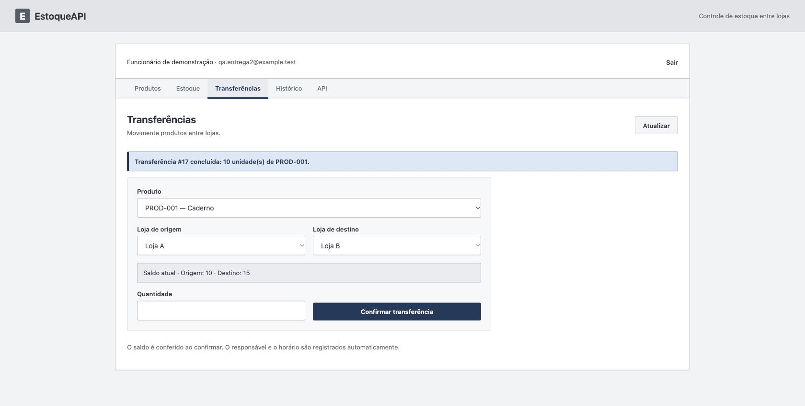
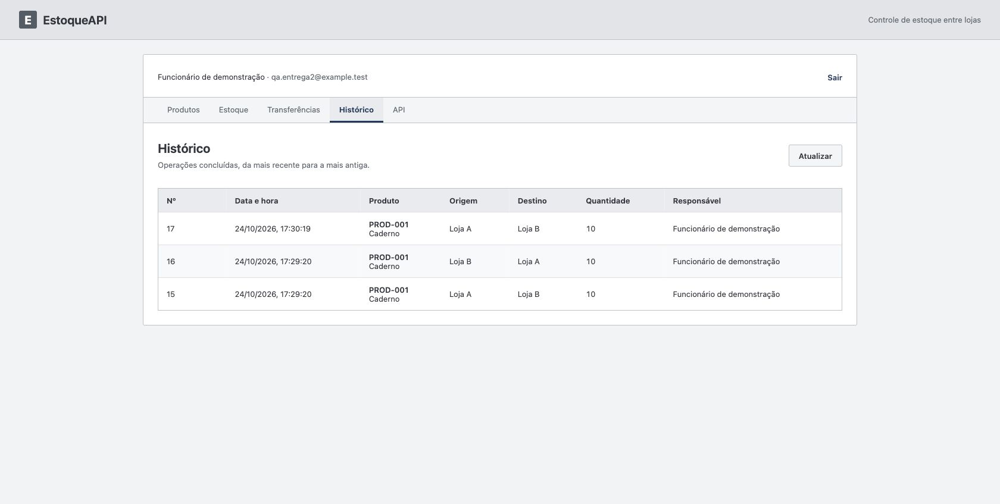
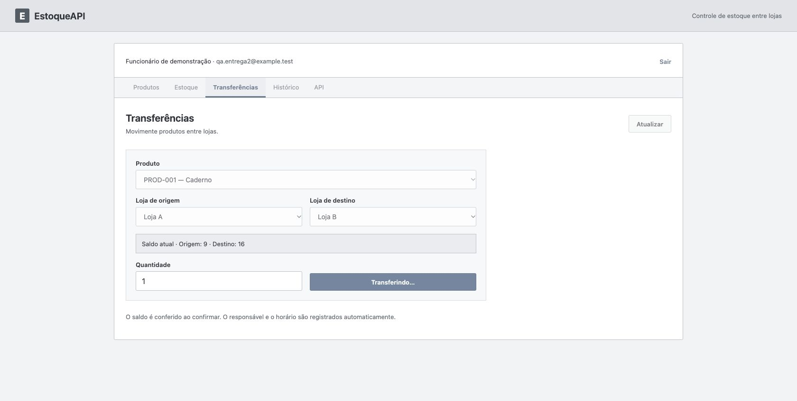

# Relatório de Execução e Gestão de Testes

Entrega 2  •  EstoqueAPI  •  Qualidade de Software

IBMR Barra da Tijuca • Turma da noite
Professoras Vanessa e Angela
Gabriel Quintanilha da Silva • Gustavo Quintanilha da Silva • Roger Ribeiro Santos

Ciclo realizado em 24/10/2026, entre 17:27 e 17:33, fuso America/Sao_Paulo. Consolidação documental após a execução. Prazo informado no enunciado: 03/12.

## 1 Resultado do ciclo

Os 25 casos acadêmicos CT01–CT25 foram aprovados nesta rodada, incluindo os 18 de prioridade alta. A suíte passou com 39 execuções JUnit, e a coleção Postman passou com 30 cenários e 44 asserções. As contagens de código, de cenários Postman e de casos acadêmicos são independentes. Cada CT foi aprovado somente após conferir suas verificações previstas, inclusive as variações e os complementos de interface quando aplicáveis.

Não foi confirmado defeito funcional novo. Houve um impedimento do sandbox, resolvido com execução autorizada fora dele. As evidências de 03/10 e os nove unitários do pacote de preparação não foram contados como execução atual.

| Indicador acadêmico | Resultado |
| --- | --- |
| Casos planejados / executados | 25 / 25 |
| Aprovados / reprovados | 25 / 0 |
| Bloqueados / não executados | 0 / 0 ao encerrar o ciclo |
| Críticos aprovados | 18 de 18 |
| Taxa de aprovação | 25 ÷ 25 × 100 = 100% |
| Defeitos funcionais novos | 0 confirmados nos cenários executados |

Execução técnica: Codex, em sessão solicitada por Roger. A execução foi assistida por ferramentas; não se atribui execução manual aos integrantes. Revisão humana, validação do grupo e submissão acadêmica continuam sob responsabilidade dos três alunos.

## 2 Versão e ambiente

Commit-base: a84a4f8d3cef994b006afec54c4c2bebf8b9d447. A aplicação Java e os componentes React não foram alterados. A versão local acrescenta asserções, proteção da base de testes e proxy configurável do Vite. As fontes exatas estão identificadas em evidencias/fontes-sha256.txt; não houve commit nem envio ao GitHub.

| Componente | Configuração observada |
| --- | --- |
| Sistema | macOS 27.0.1, build 26A434, arquitetura ARM64 |
| Backend | Java 21.0.5; Spring Boot 3.5.16; Maven Wrapper; API local 8081 |
| Banco | PostgreSQL 17.11; Docker Server 27.4.0; estoque_test, usuário estoque_test, loopback 5434; tmpfs |
| Frontend | Node 22.14.0; npm 10.9.2; React 19.2.8; Vite 8.3.2; portas 5174 e 5175 |
| Navegador e API | Chrome 155.0.8059.85; Newman 6.2.2 |
| Instrumentação do CT25 | Proxy local 8082 → 8081; atraso de 8 s somente no POST de transferência |

Modo validado: PostgreSQL em contêiner, backend e frontend executados no host. O Compose completo da aplicação não foi construído neste ciclo. Nenhum contêiner de desenvolvimento foi iniciado; a porta 5433 e os dados de desenvolvimento não foram utilizados. Somente o contêiner temporário de teste foi recriado entre as rodadas.

## 3 Procedimento e evidências da execução

A revisão cobriu README, especificação EstoqueAPI.md, código de backend e frontend, cinco classes de testes, migração SQL, coleção Postman, plano local, registros históricos, Entrega 1 atualizada, enunciado e roteiro de preparação da Entrega 2. Os documentos foram usados como referências acadêmicas; ações sobre o ambiente seguiram o pedido desta sessão.

A base de testes foi iniciada limpa. A suíte original foi executada; em seguida a API e a interface foram iniciadas com configuração explícita para estoque_test. A coleção executou antes da interface e devolveu os dez itens transferidos à origem. Produtos e histórico de teste permaneceram somente até a coleta das evidências. A regressão final usou novamente uma base limpa.

| Etapa | Resultado real | Registro |
| --- | --- | --- |
| Inicialização | Docker e PostgreSQL saudáveis; API 8081 e Vite 5174 iniciados | ambiente-docker.txt; relato-interface.md |
| Primeira tentativa restrita | 39 erros de infraestrutura; sem conclusão acadêmica nessa tentativa | impedimentos.txt |
| Baseline fora do sandbox | 39/39 passaram; término 17:28:26 | junit-baseline.xml; backend-baseline.txt |
| Postman | 30 cenários; 43 chamadas incluindo CSRF; 44 asserções; zero falhas | postman-resultados.json |
| Interface | Fluxo completo e CT25 aprovados no Chrome | capturas 01–13; ct25-rede.jsonl; saldos SQL |
| Regressão final | 39/39 passaram; término 17:33:24; lint e build passaram | junit-regressao.xml; backend-regressao.txt; frontend-*-regressao.txt |

Os registros XML exportados preservam nomes, duração e contagens; propriedades e saídas brutas foram removidas. O relatório Newman preserva nomes, status e asserções, sem headers, corpos ou variáveis. O proxy registra somente método, rota, status e instantes. Os horários UTC dos registros JSON podem ser convertidos para São Paulo subtraindo três horas nesta data.

## 4 Técnicas de caixa preta e caixa branca

### Caixa preta

Foram aplicadas partições de equivalência e análise de valores de fronteira sem depender da estrutura interna do serviço. Para origem com 20, os valores 0, 1, 20 e 21 representam inválido, menor válido, saldo exato e saldo excedido. CT10 rejeitou 0; CT20 aceitou 1 e 20; CT09 rejeitou 21 preservando os dados. CT19 verificou -1 e 1.5. CT18 verificou limites de código 60/61 e nome 150/151. A técnica foi escolhida porque esses limites são contratos observáveis dos requisitos.

### Caixa branca

TransferenciaServiceTests percorreu decisões internas de validar, lojas iguais, origem insuficiente, transferência aceita e destino ausente. verifyNoInteractions confirmou que entradas 0 e -1 não acessam repositories. InOrder verificou save do destino, flush dos saldos e saveAndFlush do histórico. ProdutoServiceTests distinguiu SQLState 23505 de outras falhas de integridade. Integração verificou que a transação realmente desfaz o débito e a criação de destino quando o histórico falha. A técnica foi escolhida para examinar caminhos e ordem de colaboração que a resposta HTTP isolada não demonstra. Não foi medida cobertura percentual nem se afirma cobertura total de ramos.

## 5 Automação e vínculo acadêmico

Os três casos mínimos CT09, CT10 e CT12 foram automatizados e aprovados com PostgreSQL real. CT09 combina a chamada HTTP 409 com preservação de saldos e histórico; CT10 combina HTTP 400 e ausência de movimentação; CT12 confere 10/15, soma 25 e um histórico após a transação. Os respectivos métodos são indicados no roteiro a seguir.

Legenda de fontes: AC = AcessoConsultasTests; TI = TransferenciaIntegrationTests; TU = TransferenciaServiceTests; PU = ProdutoServiceTests; BASE = EstoqueApiApplicationTests. As referências JUnit de cada CT devem ser lidas em conjunto com junit-regressao.xml e com os fontes empacotados. Os números dos cenários Postman são os prefixos da coleção, não IDs acadêmicos.

## 6 Matriz consolidada de rastreabilidade

| Caso | Requisito | Prioridade | Tipo principal | Status |
| --- | --- | --- | --- | --- |
| CT01 | RF01 | Alta | Sistema / API | APROVADO |
| CT02 | RF01 | Alta | Validação / API | APROVADO |
| CT03 | RF02 | Média | Integração / API | APROVADO |
| CT04 | RF02 | Média | Validação / API | APROVADO |
| CT05 | RF03 | Média | Sistema / API | APROVADO |
| CT06 | RF03 | Baixa | Validação / API | APROVADO |
| CT07 | RF04 | Alta | Sistema / Integração | APROVADO |
| CT08 | RF05 | Alta | Validação / API | APROVADO |
| CT09 | RF05 | Alta | Validação / API | APROVADO |
| CT10 | RF05 | Alta | Validação / API | APROVADO |
| CT11 | RF05 | Alta | Validação / API | APROVADO |
| CT12 | RF05 | Alta | Integração | APROVADO |
| CT13 | RF01–RF06 | Alta | Sistema / E2E | APROVADO |
| CT14 | RF06 | Média | Integração | APROVADO |
| CT15 | RF06 | Média | Sistema / API | APROVADO |
| CT16 | RF01 | Alta | API | APROVADO |
| CT17 | RF01, RF02, RF05 | Alta | API | APROVADO |
| CT18 | RF02 | Média | Validação / API | APROVADO |
| CT19 | RF05 | Alta | Validação / API | APROVADO |
| CT20 | RF05 | Alta | Integração | APROVADO |
| CT21 | RF04, RF05 | Alta | Validação / API | APROVADO |
| CT22 | RF05, RF06 | Alta | Integração | APROVADO |
| CT23 | RF05 | Alta | Integração / Concorrência | APROVADO |
| CT24 | RF05 | Alta | Validação / Integração | APROVADO |
| CT25 | RF01, RF05 | Alta | Sistema | APROVADO |

Os 25 IDs foram preservados. Uma variação, um método parametrizado ou uma repetição não aumenta o total planejado. Todos os CTs estão aprovados no fechamento desta rodada; resultados reprovados, bloqueados e não executados são zero. As evidências detalhadas abaixo sustentam a decisão por caso.

## 7 Roteiro e resultados por caso

Pré-condições comuns: base exclusiva de testes; usuário fictício; IDs obtidos por consultas; sessão e CSRF válidos, exceto quando o objetivo é testá-los. Os casos de integração preparam produtos e lojas próprios e removem seus dados. A revisão humana dos resultados ainda não foi realizada pelo grupo.

### CT01 Login válido

Requisito RF01 • Prioridade Alta • Sistema / API

Objetivo: verificar login válido.

Pré-condição: Usuário fictício cadastrado; sessão anônima e CSRF válido.

Dados: Credenciais locais de teste. Não incluir senha ou token na evidência.

Passos: Obter CSRF; enviar login; consultar /api/auth/me; conferir acesso aos módulos.

Resultado esperado: Login e consulta retornam 200; sessão iniciada; dados do funcionário sem senha/hash.

Resultado obtido: Login válido iniciou sessão; /me retornou 200 com nome e e-mail, sem hash. O Chrome apresentou catálogo e módulos; recarregar preservou a sessão.

Status: APROVADO. Evidência: AC.sessaoCsrfFixationERenovacaoLogoutFuncionam; 01-catalogo.png; relato-interface.md.

### CT02 Login inválido

Requisito RF01 • Prioridade Alta • Validação / API

Objetivo: verificar login inválido.

Pré-condição: Sem sessão autenticada; CSRF válido.

Dados: E-mail existente com senha incorreta; depois e-mail inexistente.

Passos: Tentar login com cada combinação; consultar /api/auth/me após a rejeição.

Resultado esperado: 401; mensagem de credenciais inválidas; nenhuma sessão autenticada.

Resultado obtido: Senha incorreta e e-mail inexistente retornaram 401. /me sem autenticação também retornou 401. A interface exibiu E-mail ou senha inválidos.

Status: APROVADO. Evidência: AC.rejeitaCredenciaisInvalidasSemRedirecionamento; postman-resultados.json, cenários 03 e 30; relato-interface.md.

### CT03 Cadastro válido e normalização

Requisito RF02 • Prioridade Média • Integração / API

Objetivo: verificar cadastro válido e normalização.

Pré-condição: Autenticado; código exclusivo ainda inexistente.

Dados: Código com minúsculas e espaços externos; nome com espaços externos.

Passos: Enviar cadastro; anotar ID; consultar produto; conferir persistência no banco de testes.

Resultado esperado: 201; código em maiúsculas; campos sem espaços externos; um produto persistido.

Resultado obtido: POST com código e nome cercados de espaços retornou 201; código CT-001 e nome Produto teste foram normalizados. Consulta por ID e repository confirmaram persistência. No Chrome, E2E-ENTREGA2 foi cadastrado e exibido.

Status: APROVADO. Evidência: AC.cadastraNormalizaEConsultaProduto; postman-resultados.json, 10 e 11; 01-catalogo.png.

### CT04 Código duplicado

Requisito RF02 • Prioridade Média • Validação / API

Objetivo: verificar código duplicado.

Pré-condição: Autenticado; PROD-001 existente.

Dados: Código prod-001 com espaços externos; nome Outro.

Passos: Anotar quantidade de produtos; cadastrar código repetido; consultar novamente.

Resultado esperado: 409 CODIGO_DUPLICADO; nenhum novo produto, inclusive após normalização.

Resultado obtido: Código prod-001 com espaços foi rejeitado com 409 CODIGO_DUPLICADO; a contagem permaneceu em dois produtos no teste isolado. Unitário confirmou a tradução da violação de unicidade mesmo sem detecção prévia.

Status: APROVADO. Evidência: AC.rejeitaCodigoDuplicadoNormalizado; PU.traduzDuplicacaoMesmoQuandoPreConsultaNaoEncontraCodigo; Postman 12.

### CT05 Catálogo e consulta por ID

Requisito RF03 • Prioridade Média • Sistema / API

Objetivo: verificar catálogo e consulta por id.

Pré-condição: Autenticado; produto cadastrado e ID obtido na resposta.

Dados: ID real do produto criado exclusivamente para o caso.

Passos: Abrir catálogo e localizar o produto; consultar GET /api/produtos/{id}.

Resultado esperado: Produto visível na interface; API retorna 200 com ID, código e nome corretos.

Resultado obtido: O produto criado foi retornado por ID com 200 e apareceu no catálogo. No Chrome, E2E-ENTREGA2, Produto Entrega 2 e ID 20 estavam visíveis. IDs são os observados nesta rodada.

Status: APROVADO. Evidência: AC.cadastraNormalizaEConsultaProduto; Postman 11; 01-catalogo.png.

### CT06 Produto inexistente

Requisito RF03 • Prioridade Baixa • Validação / API

Objetivo: verificar produto inexistente.

Pré-condição: Autenticado; ID sem correspondência confirmado.

Dados: ID inexistente, por exemplo -1 no teste já implementado.

Passos: Consultar GET /api/produtos/{id}; registrar status e corpo.

Resultado esperado: 404 com mensagem de produto não encontrado.

Resultado obtido: GET de produto com ID -1 retornou 404 PRODUTO_NAO_ENCONTRADO; o ID é impossível para os dados gerados pela aplicação. A coleção também verificou ID positivo inexistente.

Status: APROVADO. Evidência: AC.recursoInexistenteEIdInvalidoRetornamErrosClaros; Postman 14.

### CT07 Estoque por loja e saldo zero

Requisito RF04 • Prioridade Alta • Sistema / Integração

Objetivo: verificar estoque por loja e saldo zero.

Pré-condição: Base de testes preparada com saldos conhecidos.

Dados: Caderno 20 em A e 5 em B; Caneta sem estoque em B.

Passos: Consultar A e B pela API e interface; comparar saldos; contar registros antes/depois.

Resultado esperado: Caderno 20/5; Caneta zero em B; consulta não cria estoque ausente.

Resultado obtido: API e Chrome mostraram Caderno A20/B5; Caneta em B foi apresentada como zero. A contagem de estoques permaneceu em três após consulta; não houve criação do registro ausente.

Status: APROVADO. Evidência: AC.listaLojasEIncluiEstoqueZeroSemCriarRegistro; BASE.carregaDadosConhecidosComSenhaProtegida; 02 e 03; banco-antes-ct25.txt.

### CT08 Resposta de transferência válida

Requisito RF05 • Prioridade Alta • Validação / API

Objetivo: verificar resposta de transferência válida.

Pré-condição: Autenticado; origem com 20, destino com 5; CSRF válido.

Dados: Produto e lojas existentes; quantidade 10.

Passos: Enviar POST /api/transferencias; conferir status e campos da resposta.

Resultado esperado: 201; produto, origem, destino e quantidade correspondem à solicitação.

Resultado obtido: POST válido retornou 201 e quantidade 10. Asserções ampliadas confirmaram os IDs do produto, origem e destino exatamente como enviados, além do usuário da sessão.

Status: APROVADO. Evidência: TI.apiExigeSessaoECsrfEDevolveHistoricoSeguroOrdenado; Postman 22; 05-transferencia.png.

### CT09 Saldo insuficiente

Requisito RF05 • Prioridade Alta • Validação / API

Objetivo: verificar saldo insuficiente.

Pré-condição: Autenticado; origem com 20 e destino com 5; histórico inicial anotado.

Dados: Quantidade 21.

Passos: Consultar saldos/histórico; tentar transferir; consultar novamente.

Resultado esperado: 409 SALDO_INSUFICIENTE; saldos 20/5 e histórico inalterados.

Resultado obtido: Tentativa de 21 unidades com origem 20 retornou 409 SALDO_INSUFICIENTE; os saldos permaneceram 20/5 e o histórico do produto permaneceu vazio. A mesma rejeição foi apresentada na interface.

Status: APROVADO. Evidência: TI.apiValidaQuantidadeLojasERecursosSemAlterarSaldos; TI.saldoInsuficienteOuOrigemAusenteNaoAlteraNada; TU.saldoInsuficienteNaoGravaDestinoNemHistorico; 04-saldo-insuficiente.png.

### CT10 Quantidade zero

Requisito RF05 • Prioridade Alta • Validação / API

Objetivo: verificar quantidade zero.

Pré-condição: Autenticado; produto e lojas existentes; estado inicial anotado.

Dados: Quantidade 0.

Passos: Enviar transferência com zero; consultar saldos e histórico.

Resultado esperado: 400; nenhum débito, crédito ou histórico criado.

Resultado obtido: Quantidade 0 retornou 400 na API, preservou saldos 20/5 e não gerou histórico. O unitário confirmou rejeição antes de qualquer interação com repositories.

Status: APROVADO. Evidência: TI.apiValidaQuantidadeLojasERecursosSemAlterarSaldos; TU.rejeitaQuantidadeInvalidaAntesDeAcessarBanco[0]; Postman 16.

### CT11 Origem igual ao destino

Requisito RF05 • Prioridade Alta • Validação / API

Objetivo: verificar origem igual ao destino.

Pré-condição: Autenticado; estado inicial conhecido.

Dados: Mesma loja para origem e destino; quantidade 1.

Passos: Enviar transferência; registrar erro; consultar saldos e histórico.

Resultado esperado: 400; nenhuma movimentação ou histórico.

Resultado obtido: Mesma loja na origem e destino retornou 400; saldos e histórico permaneceram intactos. O unitário confirmou LOJAS_IGUAIS e ausência de acesso aos repositories.

Status: APROVADO. Evidência: TI.apiValidaQuantidadeLojasERecursosSemAlterarSaldos; TU.rejeitaLojasIguais; Postman 18.

### CT12 Persistência e conservação dos saldos

Requisito RF05 • Prioridade Alta • Integração

Objetivo: verificar persistência e conservação dos saldos.

Pré-condição: Autenticado; produto com 20 em A e 5 em B; histórico inicial anotado.

Dados: Quantidade 10 de A para B.

Passos: Executar transferência; consultar banco por transação independente; conferir origem, destino e soma.

Resultado esperado: Saldos 10/15; soma 25; exatamente uma transferência concluída registrada.

Resultado obtido: Transferência de 10 foi confirmada por leituras independentes após o serviço transacional: origem 10, destino 15, soma 25 e exatamente um histórico para o produto do caso. A interface mostrou os dois saldos.

Status: APROVADO. Evidência: TI.transferenciaValidaPreservaTotalERegistraResponsavelEHorario; TU.transfereSaldoParcialOuExatoEGravaAposSaldos[10]; 05 a 08; banco-antes-ct25.txt.

### CT13 Fluxo completo e logout

Requisito RF01–RF06 • Prioridade Alta • Sistema / E2E

Objetivo: verificar fluxo completo e logout.

Pré-condição: Interface, API e banco de testes disponíveis; saldos iniciais conhecidos.

Dados: Funcionário fictício; produto e lojas da base; transferência de 10.

Passos: Fazer login; abrir catálogo; consultar estoque; transferir; conferir saldos das duas lojas; consultar histórico; sair; tentar consulta protegida sem sessão.

Resultado esperado: Mensagem de sucesso; saldos corretos; histórico com responsável/data; após logout, nova consulta protegida retorna 401.

Resultado obtido: No Chrome: login, catálogo, estoque, transferência de 10, sucesso, saldos A10/B15 e histórico com responsável e horário passaram. Sair mostrou confirmação e acesso protegido posterior foi negado; a repetição instrumentada registrou GET /me com 401.

Status: APROVADO. Evidência: 01 a 10; ct25-rede.jsonl, logout 204 e /me 401; relato-interface.md; AC.sessaoCsrfFixationERenovacaoLogoutFuncionam.

### CT14 Responsável e horário do histórico

Requisito RF06 • Prioridade Média • Integração

Objetivo: verificar responsável e horário do histórico.

Pré-condição: Autenticado; funcionário da sessão identificado; horário inicial anotado.

Dados: Uma transferência válida.

Passos: Registrar horário antes/depois; transferir; conferir registro e funcionário autenticado.

Resultado esperado: Um registro com ID, produto, lojas, quantidade, horário do servidor dentro do intervalo e responsável da sessão.

Resultado obtido: Uma transferência gerou um histórico; usuário correspondeu à sessão, e o instante do servidor ficou entre os horários anotados antes e depois da chamada. Campos foram exibidos no histórico do Chrome.

Status: APROVADO. Evidência: TI.transferenciaValidaPreservaTotalERegistraResponsavelEHorario; TI.apiExigeSessaoECsrfEDevolveHistoricoSeguroOrdenado; 08-historico.png.

### CT15 Consulta e ordenação do histórico

Requisito RF06 • Prioridade Média • Sistema / API

Objetivo: verificar consulta e ordenação do histórico.

Pré-condição: Autenticado; duas ou mais transferências de teste concluídas.

Dados: Operações em instantes diferentes e operações com data/hora empatada no banco exclusivo.

Passos: Consultar histórico; conferir todos os campos; provocar empate apenas no banco de testes; verificar desempate por ID.

Resultado esperado: Ordem por data/hora decrescente e, em empate, ID decrescente; campos corretos na API e interface.

Resultado obtido: Histórico foi devolvido com o ID mais recente primeiro. O teste empatou datas somente no banco exclusivo e confirmou desempate por ID decrescente. A interface exibiu número, data/hora, produto, lojas, quantidade e responsável em ordem recente.

Status: APROVADO. Evidência: TI.apiExigeSessaoECsrfEDevolveHistoricoSeguroOrdenado; 08-historico.png; 13-ct25-historico.png.

### CT16 Acesso sem autenticação

Requisito RF01 • Prioridade Alta • API

Objetivo: verificar acesso sem autenticação.

Pré-condição: Cliente sem sessão; CSRF válido para isolar a ausência de autenticação nas escritas.

Dados: Consultas de negócio e tentativa de transferência.

Passos: Consultar rotas protegidas; tentar transferência anônima com CSRF válido; conferir dados.

Resultado esperado: 401; nenhuma operação protegida executada.

Resultado obtido: Consultas protegidas sem sessão retornaram 401, incluindo documentação. POST de transferência anônima com CSRF válido retornou 401, isolando autenticação da proteção CSRF; estado permaneceu intacto.

Status: APROVADO. Evidência: AC.exigeAutenticacaoNasConsultasEDocumentacao; TI.apiExigeSessaoECsrfEDevolveHistoricoSeguroOrdenado; Postman 01.

### CT17 Proteção CSRF

Requisito RF01, RF02, RF05 • Prioridade Alta • API

Objetivo: verificar proteção csrf.

Pré-condição: Login sem token; para operações de negócio, sessão autenticada preparada.

Dados: Token ausente e token inválido; cadastro e transferência de teste.

Passos: Enviar login/cadastro/transferência sem token ou com token inválido; conferir estado antes/depois.

Resultado esperado: 403; nenhum login ou gravação indevida.

Resultado obtido: Login, cadastro e transferência foram rejeitados com 403 tanto sem token quanto com token inválido. Login não iniciou autenticação; cadastro não criou produto; transferência preservou saldos e histórico. Logout sem token também foi rejeitado.

Status: APROVADO. Evidência: AC.csrfProtegeLoginCadastroELogout; TI.apiExigeSessaoECsrfEDevolveHistoricoSeguroOrdenado; Postman 02 e 21.

### CT18 Campos e fronteiras do produto

Requisito RF02 • Prioridade Média • Validação / API

Objetivo: verificar campos e fronteiras do produto.

Pré-condição: Autenticado; códigos exclusivos para entradas aceitas.

Dados: Campos ausentes/vazios; código com 60 e 61 caracteres; nome com 150 e 151.

Passos: Enviar cada entrada separadamente; registrar status; consultar quantidade de produtos criada.

Resultado esperado: Vazios e acima do limite retornam 400; limites exatos são aceitos com 201; rejeições não criam registros.

Resultado obtido: Campos ausentes/vazios, código 61 e nome 151 retornaram 400, com contagem inalterada. Código 60 e nome 150 retornaram 201, valores completos e exatamente um produto adicional. JSON malformado também foi rejeitado.

Status: APROVADO. Evidência: AC.validaCamposLimitesEJson; AC.aceitaTamanhosMaximosPermitidos; Postman 13.

### CT19 Quantidades negativa e fracionária

Requisito RF05 • Prioridade Alta • Validação / API

Objetivo: verificar quantidades negativa e fracionária.

Pré-condição: Autenticado; saldos e histórico inicial registrados.

Dados: Quantidade -1 e 1,5 no formulário; JSON usa 1.5.

Passos: Enviar cada valor pela API; conferir erro; consultar saldos e histórico.

Resultado esperado: 400 para ambos; nenhuma movimentação.

Resultado obtido: Quantidade -1 e JSON com 1.5 retornaram 400; saldos 20/5 e histórico vazio foram preservados. O unitário parametrizado cobriu -1 antes do acesso ao banco.

Status: APROVADO. Evidência: TI.apiValidaQuantidadeLojasERecursosSemAlterarSaldos; TU.rejeitaQuantidadeInvalidaAntesDeAcessarBanco[-1]; Postman 17.

### CT20 Saldo exato e criação do destino

Requisito RF05 • Prioridade Alta • Integração

Objetivo: verificar saldo exato e criação do destino.

Pré-condição: Cenários independentes com dados restaurados antes de cada um.

Dados: Cenário A: origem 20, destino 5, transferir 20. Cenário B: origem 20, destino sem registro, transferir 1.

Passos: Executar A e conferir 0/25; restaurar dados; executar B e contar estoque do destino.

Resultado esperado: Saldo exato permitido; destino ausente criado uma única vez com saldo 1; origem passa a 19 no segundo cenário.

Resultado obtido: Variação A: 20 de A20/B5 produziu 0/25. Variação B, com fixture nova: 1 para destino ausente produziu origem 19 e destino 1, com exatamente um registro de estoque no destino.

Status: APROVADO. Evidência: TI.permiteConsumirSaldoExato; TI.criaDestinoAusenteEAceitaUmaUnidade; TU.transfereSaldoParcialOuExatoEGravaAposSaldos[20]; TU.destinoAusenteComecaComZero.

### CT21 Referências inexistentes

Requisito RF04, RF05 • Prioridade Alta • Validação / API

Objetivo: verificar referências inexistentes.

Pré-condição: Autenticado; estado inicial anotado; IDs inexistentes confirmados.

Dados: Loja inexistente na consulta; produto, origem e destino inexistentes na transferência, um por vez.

Passos: Executar consulta e cada variação de transferência; comparar saldos/histórico e registros antes/depois.

Resultado esperado: 404; nenhuma escrita.

Resultado obtido: Consulta de loja inexistente e transferências com produto, origem ou destino inexistentes, isoladamente, retornaram 404. Os saldos e o histórico do produto de teste permaneceram intactos.

Status: APROVADO. Evidência: AC.recursoInexistenteEIdInvalidoRetornamErrosClaros; TI.apiValidaQuantidadeLojasERecursosSemAlterarSaldos.

### CT22 Rollback após falha no histórico

Requisito RF05, RF06 • Prioridade Alta • Integração

Objetivo: verificar rollback após falha no histórico.

Pré-condição: Banco exclusivo de testes; não usar desenvolvimento; trigger de falha controlada disponível.

Dados: Origem com 20; transferência de 10; destino existente e ausente em verificações separadas.

Passos: Instalar trigger que detecta débito real e falha no histórico; transferir; verificar rollback e resposta HTTP; remover trigger/função ao final.

Resultado esperado: 500 genérico pela API; saldos originais; nenhum histórico; destino recém-criado desfeito.

Resultado obtido: Trigger confirmou que o débito real atingiu o banco e provocou falha no histórico. O rollback restaurou 20/5, removeu destino recém-criado e manteve histórico vazio; a API devolveu 500 ERRO_INTERNO sem detalhe do trigger. Destinos ausente e existente foram verificados separadamente. Trigger removido após o teste.

Status: APROVADO. Evidência: TI.falhaNoHistoricoAposDebitoRealDesfazSaldosENovoDestino; banco-apos-regressao.txt.

### CT23 Transferências concorrentes

Requisito RF05 • Prioridade Alta • Integração / Concorrência

Objetivo: verificar transferências concorrentes.

Pré-condição: Banco exclusivo; transações independentes sincronizadas; dados próprios em cada variação.

Dados: A: duas de 8 com origem 10 e destino 5. B: A20 e B5 enviam 5 para destino ausente. C: A20 envia 3 a B5 e B envia 2 a A.

Passos: Disparar em paralelo por barreira; aguardar conclusões; consultar saldos, unicidade e histórico; aplicar timeout.

Resultado esperado: A: uma aceita e outra rejeitada, saldos 2/13 e um histórico. B: 15/0/10 e único estoque no destino. C: 19/6, dois históricos e sem travamento.

Resultado obtido: A: duas de 8 com origem 10 tiveram uma aceitação e uma rejeição, saldos 2/13 e um histórico. B: créditos para destino ausente resultaram 15/0/10, um estoque de destino e dois históricos. C: sentidos opostos resultaram 19/6 e dois históricos, dentro dos timeouts. O helper mapeia retorno do serviço para 201/409; não são medições HTTP de carga.

Status: APROVADO. Evidência: TI.concorrenciaNaoPermiteGastarMesmoSaldoDuasVezes; TI.concorrenciaCriaUmUnicoDestinoSemPerderCreditos; TI.transferenciasEmSentidosOpostosNaoTravemNemPercamAtualizacoes.

### CT24 Limite inteiro do destino

Requisito RF05 • Prioridade Alta • Validação / Integração

Objetivo: verificar limite inteiro do destino.

Pré-condição: Autenticado; origem com saldo; destino preparado em banco exclusivo.

Dados: Destino com 2147483647; quantidade 1; origem com 20.

Passos: Tentar transferência; capturar resposta HTTP; consultar ambos os saldos e histórico.

Resultado esperado: 409 LIMITE_ESTOQUE; origem permanece 20; destino permanece no limite; nenhum histórico.

Resultado obtido: Destino 2147483647, origem 20 e tentativa de 1 retornaram 409 LIMITE_ESTOQUE via MockMvc. Nova leitura confirmou origem 20, destino no limite e zero histórico. O caminho do serviço também foi verificado.

Status: APROVADO. Evidência: TI.limiteDoInteiroNaoDebitaOrigem.

### CT25 Bloqueio de cliques repetidos

Requisito RF01, RF05 • Prioridade Alta • Sistema

Objetivo: verificar bloqueio de cliques repetidos.

Pré-condição: Sessão autenticada; interface 5175; proxy de observação 8082 com atraso de 8 s; API 8081 e banco estoque_test.

Dados: Uma transferência válida de 1 unidade.

Passos: Registrar saldos e histórico; preencher 1 unidade; iniciar envio; clicar cinco vezes no mesmo botão durante a espera; conferir botão desabilitado, contar POSTs no log do proxy e consultar saldos/histórico no banco.

Resultado esperado: Apenas uma requisição de transferência; botão bloqueado durante o envio; uma movimentação e um registro.

Resultado obtido: Envio exploratório de 1 unidade levou 10/15 a 9/16 (#18). Na repetição controlada, com atraso de 8 s, um clique iniciou o envio e cinco cliques adicionais no mesmo botão desabilitado não geraram outro POST: 9/16 passou a 8/17, com apenas #19 adicional. O log contém dois POSTs no total porque houve dois envios independentes; não houve duplicação em nenhum deles.

Status: APROVADO. Evidência: 11 a 13; ct25-rede.jsonl; banco-antes-ct25.txt; banco-depois-ct25.txt; codigo-testes/proxy-observacao.mjs.

## 8 Gestão dos defeitos e impedimentos

Não houve falha funcional confirmada nos CT01–CT25 nesta execução, portanto não foi aberto BUG novo nem inventada correção de produto. As respostas esperadas 400, 401, 403, 404, 409 e o 500 provocado no CT22 fazem parte dos testes aprovados. O trigger do CT22 é uma injeção controlada de falha e não representa um defeito encontrado.

### IMP01 Restrições do ambiente de execução

Descrição e ambiente: em macOS e sandbox restrito, o Docker socket, a conexão local PostgreSQL e o mecanismo inline do Mockito não ficaram acessíveis. Pré-condição: Docker disponível no host; primeira execução dentro do sandbox. Reprodução: tentar docker info ou ./mvnw verify nesse contexto. Esperado: acesso ao ambiente de teste; obtido: Operation not permitted e falhas de inicialização, com 39 erros de infraestrutura no Maven. Evidência: impedimentos.txt. Classificação: impedimento de ambiente, prioridade alta para viabilizar o ciclo; sem severidade de produto. Responsável técnico pelo tratamento: Codex nesta sessão. Status: resolvido. Tratamento: acesso autorizado fora do sandbox, sem mudar o destino do banco. Reteste baseline: 39 aprovados às 17:28:26; regressão: 39 aprovados às 17:33:24.

### Registros históricos

DEF-01 e DEF-02, descritos em 03/10, referiam-se ao destaque da confirmação e à tabela que deslocava Sair em tela menor; DEF-03 tratava documentação antiga. São registros anteriores, sem reprodução anterior à correção nesta sessão. Não foram reabertos, recontados ou apresentados como novas correções. As novas capturas comprovam a execução atual nas condições observadas, sem preencher retrospectivamente campos faltantes dos registros antigos.

## 9 Ajustes realizados e regressão

Foram ampliadas as asserções de credenciais inválidas, CSRF inválido em login e transferência, produto/lojas da resposta de transferência, fronteiras de tamanho, unicidade do estoque de destino e resposta HTTP de limite inteiro. Uma classe de apoio gera a senha fictícia em memória e restringe as conexões da suíte a estoque_test local na porta 5434. Vite passou a aceitar ESTOQUE_API_PROXY_TARGET, preservando 8080 como padrão. README recebeu as instruções correspondentes.

A suíte completa foi repetida em banco limpo após os ajustes: 39 execuções, zero falhas, erros ou ignorados. Lint e build também foram repetidos. Não houve correção funcional a retestar; o ciclo Teste → Defeito → Correção → Reteste → Regressão não foi acionado para um BUG de produto. Houve tratamento de ambiente e regressão das melhorias de teste. Não se usa esse resultado para inventar um defeito corrigido.

## 10 Limites e conclusão para revisão do grupo

A rodada atende aos critérios numéricos da Entrega 1 para demonstração acadêmica local: 25 executados, 25 aprovados, 18 críticos aprovados e nenhum defeito crítico ou alto confirmado em aberto neste ciclo. Esta conclusão está limitada aos cenários executados. A API continua sem garantia de idempotência para reenvios HTTP; CT25 verificou o bloqueio da interface durante o envio, não a deduplicação no servidor. Não foram avaliados alta carga, segurança completa ou uso em produção.

Antes do envio, o grupo deve revisar nomes, redação e evidências, confirmar que aceita a execução assistida por ferramentas e submeter o PDF e anexos no sistema acadêmico. Nenhuma publicação, commit ou envio ao GitHub foi realizado. A decisão formal de release e a análise ampliada de qualidade podem ser desenvolvidas na Entrega 3.

## 11 Seleção de capturas da execução atual

Os arquivos em evidencias/ contêm as 13 capturas originais. Esta seleção apresenta as telas centrais do fluxo; os logs, consultas SQL e relatórios JUnit complementam as imagens. Todas as capturas são de 24/10/2026, fuso de apresentação America/Sao_Paulo, versão identificada na seção 2.

## 12 Referências e organização dos anexos

Referências acadêmicas: Prova QA - A3.pdf, seção Entrega 2 nas páginas 3 a 5; Estratégia e Plano de Testes.docx atualizado, matriz CT01–CT25 e critérios do plano; Roteiro-Entrega-2-EstoqueAPI.md do pacote de preparação. Os documentos de referência não foram alterados. Seus hashes constam em evidencias/referencias-sha256.txt.

Referências do projeto: README.md, EstoqueAPI.md, docs/plano-de-testes.md, código-fonte, coleção Postman e registros de docs/evidencias/fase-5. Os registros históricos serviram apenas de contexto e não de prova desta rodada. Repositório: https://github.com/rogerr23/estoqueAPI. A URL foi obtida da configuração Git; a disponibilidade remota não foi validada e as alterações locais desta rodada ainda não estão publicadas.

Conteúdo do pacote: este PDF; versão editável Markdown; matriz CSV e resultados JSON; evidências JUnit, Newman, capturas, SQL, registros do ambiente e SHA256; cópia do código de testes e configuração necessária, coleção Postman e proxy de observação. O guia LEIA-ME.md explica como repetir a execução e localizar cada evidência.

Não distribuir .env, .env.test, ambientes Postman preenchidos, cookie jars ou relatórios brutos do Newman/Surefire. O pacote desta entrega contém versões sanitizadas. As credenciais usadas em execução não estão nas evidências exportadas.
